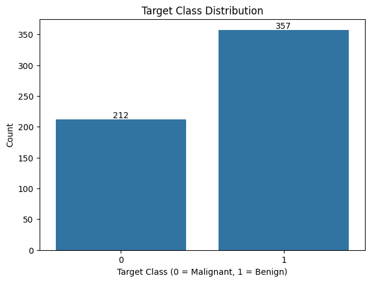
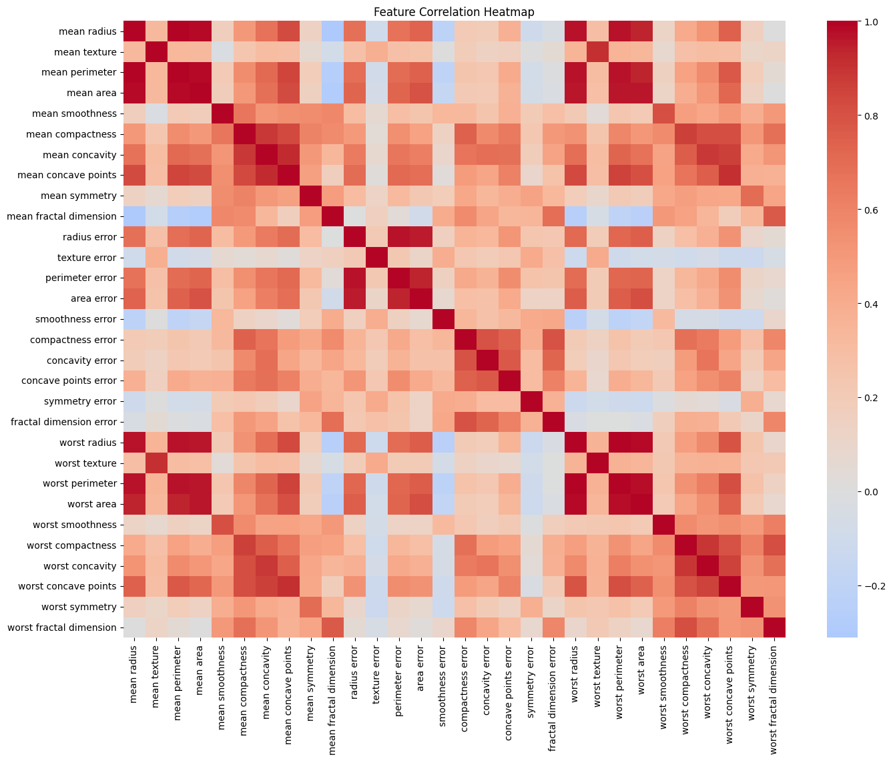
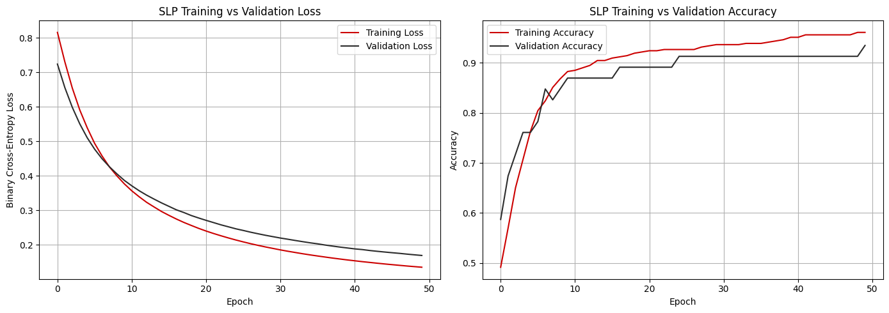
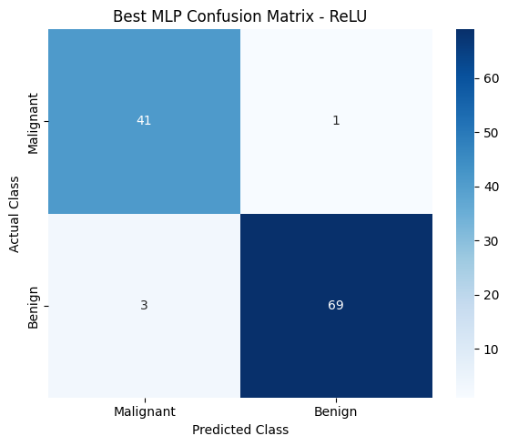
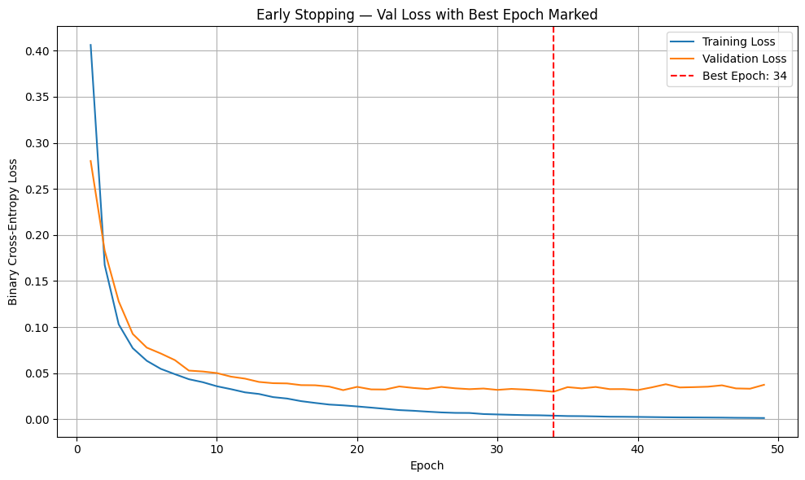
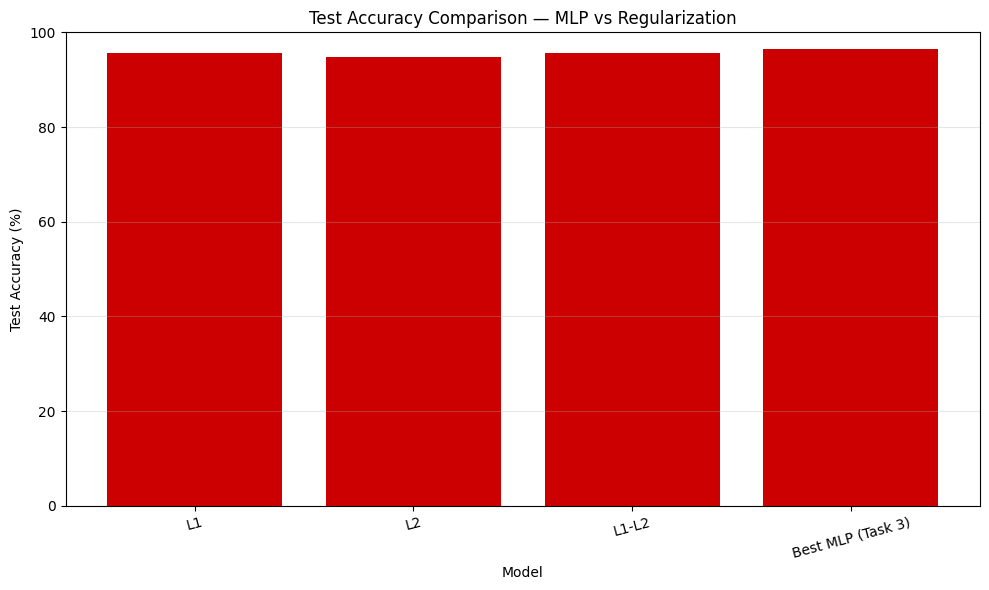
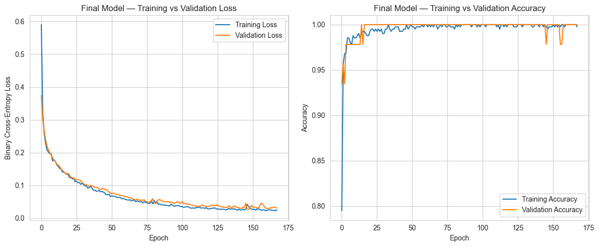
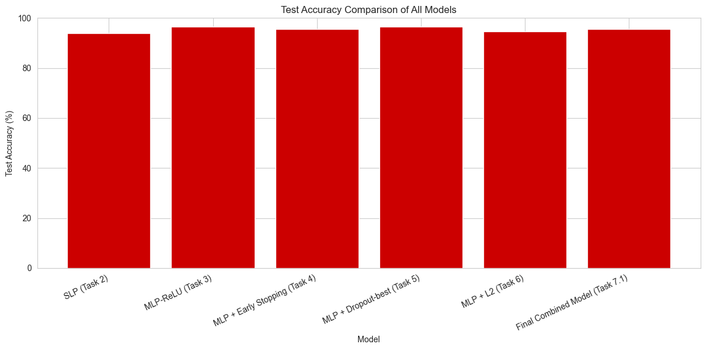
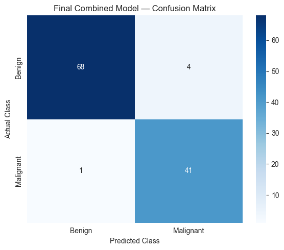

# Breast Cancer Classification using Deep Learning

A machine-learning and deep-learning project that explores the Wisconsin Breast Cancer dataset and builds neural-network models to classify tumors as **malignant** or **benign**. The notebook compares a Single-Layer Perceptron (SLP), Multi-Layer Perceptron (MLP), activation functions, and techniques intended to reduce overfitting.

> **Educational use only:** This project is not a medical diagnostic tool. Predictions must not be used for clinical decisions.

## Project Overview

The notebook is organized into seven tasks:

1. **Dataset exploration and preprocessing** — loads the breast cancer dataset, inspects features and target classes, visualizes feature correlations, splits the data, and standardizes features.
2. **Single-Layer Perceptron (SLP)** — trains a baseline neural network with a sigmoid output.
3. **Multi-Layer Perceptron (MLP)** — tests a deeper network and compares hidden-layer activation functions.
4. **Early stopping** — monitors validation loss and restores the best weights.
5. **Dropout** — compares dropout rates to help control overfitting.
6. **Regularization** — compares L1, L2, and combined L1-L2 regularization.
7. **Final combined model** — combines L2 regularization, dropout, and early stopping, compares model results, and saves the final model.

## Dataset

The notebook uses `load_breast_cancer(as_frame=True)` from `sklearn.datasets`; a separate CSV file is not required.

- **Samples:** 569
- **Input features:** 30 numeric features
- **Classes:** malignant and benign
- **Split:** 80% training and 20% testing, with stratification
- **Scaling:** `StandardScaler`, fitted on training data and then applied to both training and test sets

In the scikit-learn dataset, target `0` is malignant and target `1` is benign.

## Technologies Used

- Python
- Jupyter Notebook
- NumPy and pandas
- Matplotlib and Seaborn
- Scikit-learn
- TensorFlow / Keras

## Installation

Use Python 3.10–3.12 if your installed TensorFlow version does not support your Python version. Create and activate a virtual environment if desired.

```bash
python -m venv .venv
```

Windows:
```bash
.venv\Scripts\activate
```

Install the dependencies:
```bash
pip install numpy pandas matplotlib seaborn scikit-learn tensorflow jupyter
```

## Run the Project

1. Download or clone this repository.
2. Install the packages listed above.
3. Open the notebook `PR1(1).ipynb` in Jupyter Notebook or VS Code.
4. Run the cells **from top to bottom**, because later tasks reuse variables and models created earlier.
5. The final task saves the trained model as `final_breast_cancer_model.keras` in the current working directory.

Start Jupyter with:
```bash
jupyter notebook
```

## Visual Results

### 1. Target Class Distribution

The plot shows the number of examples in each target class.



### 2. Feature Correlation Heatmap

The heatmap visualizes correlations between the 30 numeric input features.



### 3. SLP Training Curves

Training and validation loss/accuracy for the baseline Single-Layer Perceptron.



### 4. Best MLP Confusion Matrix

An example confusion matrix produced by the MLP activation-function comparison task.



### 5. Early Stopping

Training and validation loss curves used to inspect the early-stopping behavior.



### 6. Regularization Comparison

The notebook compares model test accuracy after applying regularization methods.



### 7. Final Model Training Curves

The final combined model uses L2 regularization, dropout, and early stopping.



### 8. Model Accuracy Comparison

A comparison of test accuracy across the models included in the notebook.



### 9. Final Model Confusion Matrix

The final model's confusion matrix shows correct and incorrect classifications for the test split.



## Evaluation

The notebook evaluates models using accuracy, confusion matrices, and classification reports that include precision, recall, and F1-score. For this task, **malignant-class recall is particularly important to inspect**, because false negatives can be consequential. Review the actual notebook output for the measured values; results can vary with environment and training.

## Project Structure

```text
Breast-Cancer-Classification/
├── PR1(1).ipynb
├── README.md
└── images/
    ├── target_class_distribution.png
    ├── feature_correlation_heatmap.png
    ├── slp_training_curves.png
    ├── slp_confusion_matrix.png
    ├── activation_function_comparison.png
    ├── best_mlp_confusion_matrix.png
    ├── early_stopping_curves.png
    ├── early_stopping_comparison.png
    ├── dropout_rate_comparison.png
    ├── dropout_training_accuracy.png
    ├── regularization_training_curves.png
    ├── regularization_accuracy_comparison.png
    ├── final_model_training_curves.png
    ├── model_accuracy_comparison.png
    └── final_model_confusion_matrix.png
```

## Future Improvements

- Add cross-validation and repeated experiments.
- Report precision, recall, F1-score, and ROC-AUC for each model in one table.
- Check calibration and choose thresholds using validation data.
- Test the final model on independent external data before considering any real-world use.

## Author

Add your name, GitHub profile, and project links here before publishing.
